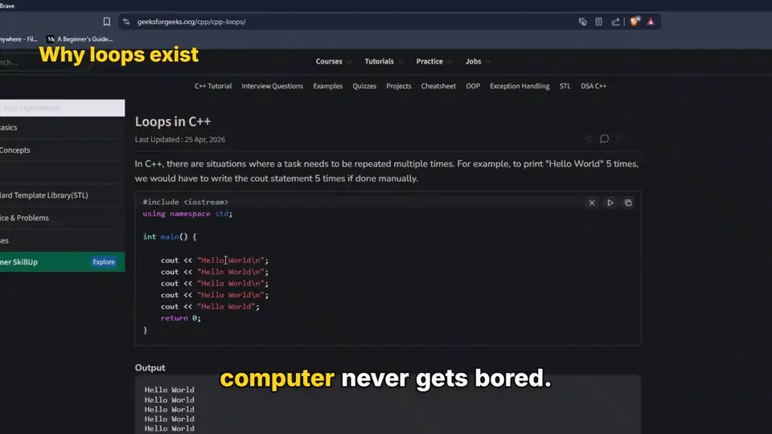
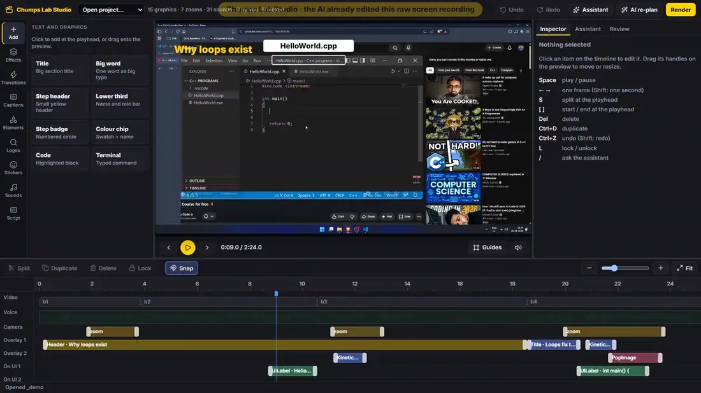
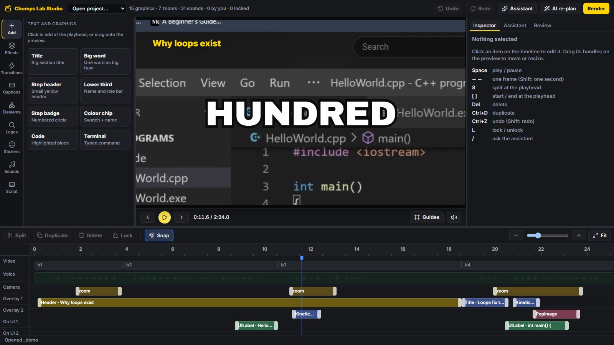
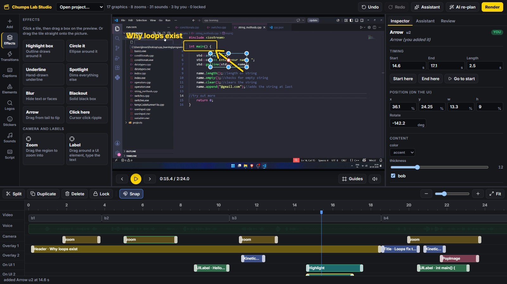
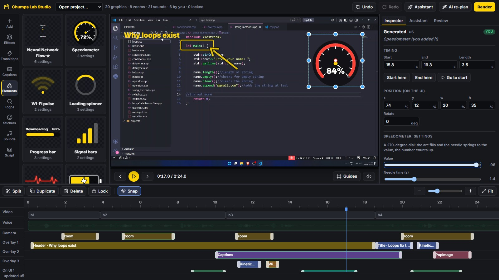
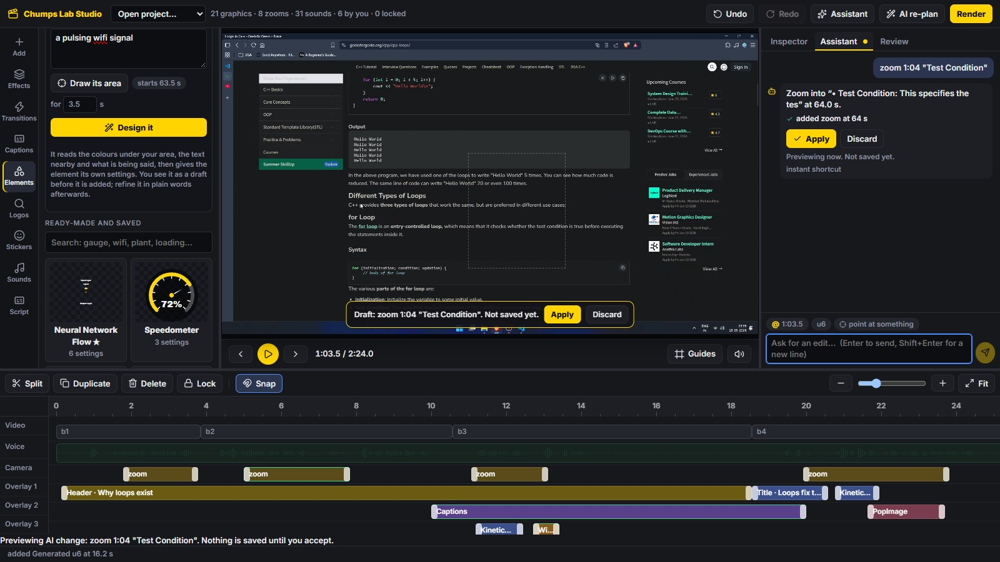
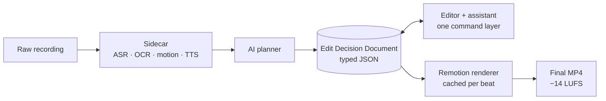

<a id="top"></a>

<h1 align="center">🎬 Chumps Lab Studio</h1>

<p align="center">
  
  
  
  
  
  
</p>

<p align="center">
  <b>An AI video editor for screen-recording tutorials.</b><br>
  It turns a raw recording into an edited video (zooms, labels, captions, sound effects, animated graphics),<br>
  then hands you a real editor, and an assistant, to change any of it.
</p>

<p align="center">
  <a href="#features"><b>Features</b></a> ·
  <a href="#how-it-works"><b>How it works</b></a> ·
  <a href="#quick-start"><b>Quick start</b></a> ·
  <a href="docs/assets/showcase.mp4"><b>Watch with sound</b></a>
</p>

<br>

<p align="center">
  
</p>
<p align="center">
  <sub><b>What it makes.</b> 18 s from a raw recording: AI-designed counter, karaoke captions, auto zoom + kinetic word, blur over third-party thumbnails, colour wipe, highlight and arrow.</sub>
</p>

<br>

<p align="center">
  
</p>
<p align="center">
  <sub><b>How you edit it.</b> Draw a zoom, draw effects, one-click transitions and captions, tune an element, have the AI design one, ask the assistant. <a href="docs/assets/editor-demo.mp4">MP4</a></sub>
</p>

## Features

- **Edits the raw recording for you.** Transcript + OCR + screen-motion analysis drive zooms, UI labels, titles, kinetic words, moods, memes and sound effects, timed to the speech and to what moves on screen.
- **Point at it, and it's done.** Every effect is placed by drawing on the picture: drag a box to zoom, highlight, blur or spotlight; drag an arrow from tail to tip; drop a tile on the preview.
- **A real editor.** Timeline with drag, trim, snap, split, lock and undo; on-canvas handles; an inspector for every setting; ten transitions (flash, dip, wipe, iris, clock, slats, whip blur…) and karaoke / pop / subtitle captions from the transcript.
- **Linked items.** Group a zoom with its spotlight, highlight or sound and they move, copy, lock and delete as one. *Zoom + spotlight* is a single drag. Switch anything off without deleting it, drop markers, ripple-delete to close a gap, copy and paste at the playhead.
- **AI-designed animated elements.** Ask for *"a speedometer at 78%"* or *"a waving plant"*. The model writes a safe, checked spec (never code), chooses its own settings (needle time, flicker rate, sway…), and fits it to the colours and text around it. Tune it with sliders or in words.
- **An assistant that edits.** *"zoom into Test Condition and add a whoosh"*. Every change arrives as a draft you Apply or Discard; the AI uses the same command layer you do.
- **Free and local.** Free cloud models first, then Bonsai 2 27B on your own GPU (~40 tokens/s on 8 GB). Kokoro TTS, CC0 sound library, CC-BY animated stickers.

## Gallery

<table>
  <tr>
    <td width="50%"></td>
    <td width="50%"></td>
  </tr>
  <tr>
    <td><sub><b>Editor.</b> Library rail, live preview, lanes for camera, overlays, UI labels and sound.</sub></td>
    <td><sub><b>Effects.</b> Highlight and arrow drawn straight onto the recording; they follow the camera.</sub></td>
  </tr>
  <tr>
    <td></td>
    <td></td>
  </tr>
  <tr>
    <td><sub><b>Elements.</b> Gallery, AI designer and the element's own settings.</sub></td>
    <td><sub><b>Assistant.</b> A request becomes a previewed draft: Apply or Discard.</sub></td>
  </tr>
</table>

## Shortcuts (Premiere Pro keys)

Press **?** in the editor for the full sheet. The ones you will use most:

| Key | Does | Key | Does |
|---|---|---|---|
| Space · J K L | play · shuttle back / stop / forward (tap again for 2×, 4×) | Ctrl+K | add edit (cut at the playhead) |
| ← → · Shift+← → | one frame · five frames | C · V | razor tool · selection tool |
| ↑ ↓ | previous / next edit point | Q · W | trim start / end to the playhead |
| I · O · X | mark In · Out · mark the selected item | ; · ' | lift · extract between In and Out |
| M · Shift+M · Ctrl+Shift+M | add marker · next · previous | Delete · Shift+Delete | remove · ripple delete |
| Ctrl+C / X / V | copy / cut / paste at the playhead | Ctrl+G · Ctrl+Shift+G | group · ungroup |
| A | select everything from the playhead | E · Ctrl+L | disable · lock |
| S · = · - · \ | snapping · zoom in · out · fit | Alt+← → | nudge a frame |

## How it works



The AI never writes code: it writes a typed **Edit Decision Document** that you can inspect, edit, lock and re-plan around. Locked and hand-edited items survive an AI re-plan.

| Folder | What |
|---|---|
| `engine/` | Remotion compositions, components, element renderer, render pipeline |
| `app/` | Editor (React) + server: command layer, assistant, element designer |
| `sidecar/` | Python: ingest, transcription, OCR, planning, compiler, TTS |
| `docs/` | Blueprint and progress notes |

## Quick start

**Windows:** double-click `startup.bat`. It installs on first run, builds the editor, starts it and opens http://localhost:4173.

```bash
npm install
cd app && npm run web          # editor at http://localhost:4173
```

Optional: put `CLS_OPENROUTER_API_KEY=...` in `.env` for the free cloud models. Without it, the local model is used (see [app/README.md](app/README.md#elements-graphics-the-ai-invents) for the Bonsai setup). Pipeline commands are in the [blueprint](docs/blueprint/).

**Verify it:** `npm test` (command layer) · `npx tsx test/element.test.ts` in `engine/` · `node ../node_modules/tsx/dist/cli.mjs test/e2e.mts` in `app/` (26 browser checks) · `pytest` in `sidecar/`.
The README media is reproducible: `test/showcase-edit.mts` and `test/demo-record.mts`.

## Built with

[Remotion](https://www.remotion.dev) · React · Zustand · react-moveable · @xzdarcy/react-timeline-editor · FFmpeg · llama.cpp ([PrismML](https://github.com/PrismML-Eng/llama.cpp)) · Kokoro TTS · Parakeet ASR · RapidOCR

<p align="right"><a href="#top">Back to top ↑</a></p>
